# Plan Contable — Manual de uso

**Tu contabilidad con el Plan Contable General Empresarial (PCGE), lista para SUNAT.**

> Las capturas usan una empresa de demostración con datos ficticios.

Este manual explica, paso a paso, con palabras simples y con capturas de cada pantalla, cómo usar la aplicación: desde crear tu cuenta hasta cerrar el mes y descargar tus libros electrónicos.

---

## Contenido

1. [Crear tu cuenta](#1-crear-tu-cuenta)
2. [Datos de tu empresa](#2-datos-de-tu-empresa)
3. [Cuentas propias (subdivisionarias)](#3-cuentas-propias-subdivisionarias)
4. [Conoce la pantalla](#4-conoce-la-pantalla)
5. [Dashboard](#5-dashboard)
6. [Buscar cuentas del PCGE](#6-buscar-cuentas-del-pcge)
7. [Registrar un asiento](#7-registrar-un-asiento)
8. [Usar plantillas: el asiento se arma solo](#8-usar-plantillas-el-asiento-se-arma-solo)
9. [Lista de asientos: revisar, corregir y anular](#9-lista-de-asientos-revisar-corregir-y-anular)
10. [Reportes](#10-reportes)
11. [Libros electrónicos (PLE) de SUNAT](#11-libros-electrónicos-ple-de-sunat)
12. [Destino de gastos y cierre del año](#12-destino-de-gastos-y-cierre-del-año)
13. [Entidades: clientes y proveedores](#13-entidades-clientes-y-proveedores)
14. [Cierre de mes](#14-cierre-de-mes)
15. [Importar asientos desde Excel](#15-importar-asientos-desde-excel)
16. [Auditoría: el historial de cambios](#16-auditoría-el-historial-de-cambios)
17. [Configuración](#17-configuración)
18. [Tu rutina de cada mes](#18-tu-rutina-de-cada-mes)
19. [Reglas que debes conocer](#19-reglas-que-debes-conocer)
20. [Preguntas frecuentes](#20-preguntas-frecuentes)

---

## 1. Crear tu cuenta

La primera vez que entras a la aplicación debes crear tu cuenta. Solo toma un minuto.

1. En la pantalla de inicio, haz clic en **"Crea una gratis"**.
2. Completa:
   - **Nombre completo.**
   - **Usuario**: el nombre con el que entrarás siempre. Sin espacios, por ejemplo `jperez` o `contabilidad.lima`.
   - **Contraseña**: mínimo 8 caracteres. Escríbela dos veces para confirmarla.
3. Presiona **Crear cuenta**.

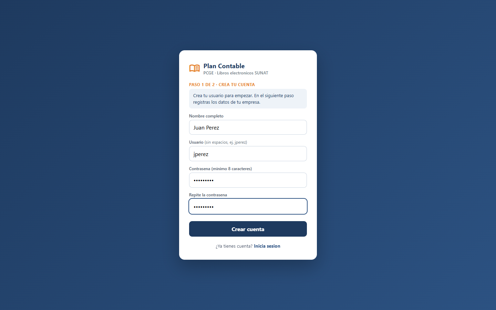
*Pantalla para crear tu cuenta*

Listo: tu cuenta queda creada y pasas directamente al paso 2, los datos de tu empresa.

> **Importante:** guarda bien tu usuario y tu contraseña. Los necesitarás cada vez que entres.

### Entrar las siguientes veces

Escribe tu **usuario** y tu **contraseña** y presiona **Ingresar**. Para salir, usa el botón **Salir** en la esquina superior derecha.

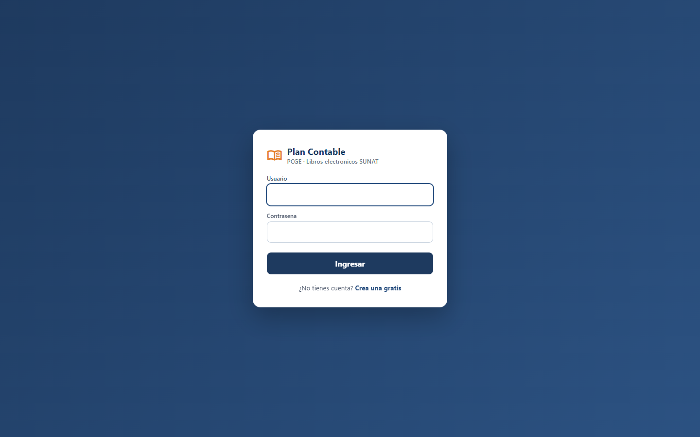
*Pantalla de inicio de sesión*

Tu información es solo tuya: nadie más ve tus asientos, tus reportes ni la configuración de tu empresa.

---

## 2. Datos de tu empresa

Después de crear tu cuenta, la aplicación te pide los datos de tu empresa:

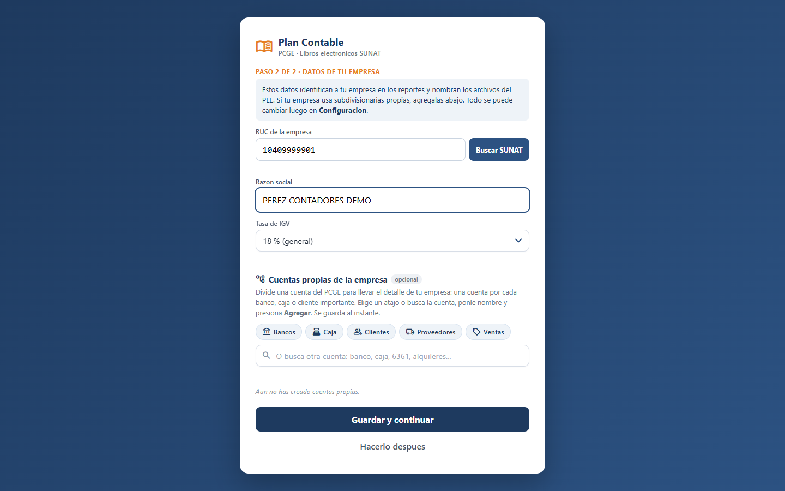
*Paso 2: datos de tu empresa*

| Dato | Para qué sirve |
|---|---|
| **RUC** | Identifica a tu empresa en los reportes y da nombre a los archivos del PLE. Escribe los 11 dígitos y presiona **Buscar SUNAT**: la razón social se completa sola. |
| **Razón social** | Aparece en los reportes, en los estados financieros y en el menú. |
| **Tasa de IGV** | **18 %** (general) o **10.5 %** (solo MYPE de restaurantes, hoteles y alojamientos turísticos que cumplen los requisitos de ley). |

En esta misma pantalla puedes agregar tus **cuentas propias** (subdivisionarias); lo explicamos en la siguiente sección.

Presiona **Guardar y continuar** y ya puedes empezar a trabajar.

> Si en ese momento no tienes los datos a la mano, puedes presionar **Hacerlo después**. La aplicación te los volverá a pedir la próxima vez que entres, y siempre puedes cambiarlos en **Configuración**.

---

## 3. Cuentas propias (subdivisionarias)

El PCGE llega hasta cierto nivel de detalle, pero cada empresa necesita llevar el suyo: una cuenta por cada banco, por cada caja o por cada cliente importante. Para eso están las **cuentas propias**.

**Ejemplo:** la cuenta **1041 Cuentas corrientes operativas** se puede dividir en:

| Código | Nombre |
|---|---|
| 10411 | BCP cuenta corriente soles |
| 10412 | BBVA cuenta corriente dólares |
| 10413 | Interbank cuenta recaudadora |

### Cómo crear una

1. Elige un **atajo** (Bancos, Caja, Clientes, Proveedores, Ventas) o **busca** la cuenta que quieres dividir, por código o por nombre.
2. La aplicación te propone el **código** que sigue (por ejemplo, 10411). Puedes cambiarlo.
3. Escribe el **nombre de la cuenta** y presiona **Agregar**. Se guarda al instante.

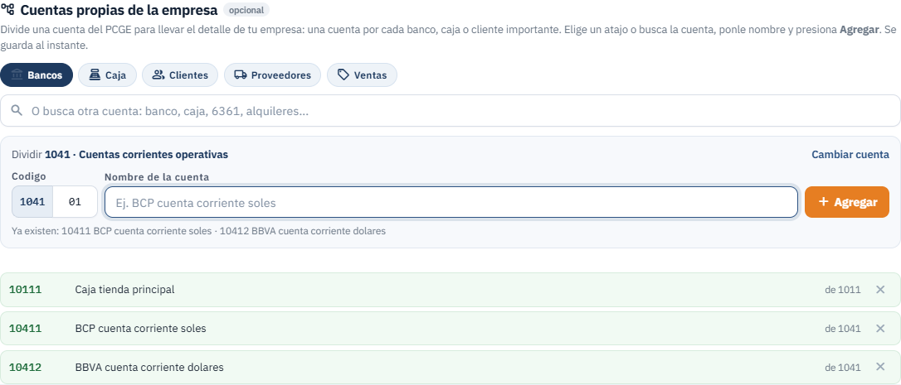
*Cuentas propias: arriba, el formulario para dividir la cuenta 1041; abajo, las cuentas ya creadas*

Desde ese momento, la cuenta nueva aparece en el buscador, en el formulario de asientos y en todos los reportes, igual que una cuenta oficial del PCGE.

Puedes crear cuentas propias al configurar tu empresa por primera vez o en cualquier momento desde **Configuración**. Para quitar una, presiona la **✕** junto a su nombre (solo si todavía no la has usado en asientos).

---

## 4. Conoce la pantalla

- **Menú lateral (izquierda):** todas las secciones, agrupadas en *General*, *Operaciones*, *Reportes*, *SUNAT* y *Mantenimiento*. Arriba está el botón naranja **Nuevo asiento**, para registrar rápido desde cualquier lugar.
- **Barra superior:** dónde estás, tu nombre y tu empresa, el botón **Salir** y el botón de **modo oscuro**.
- **En el celular:** el menú se abre con el botón ☰ de la esquina superior izquierda.

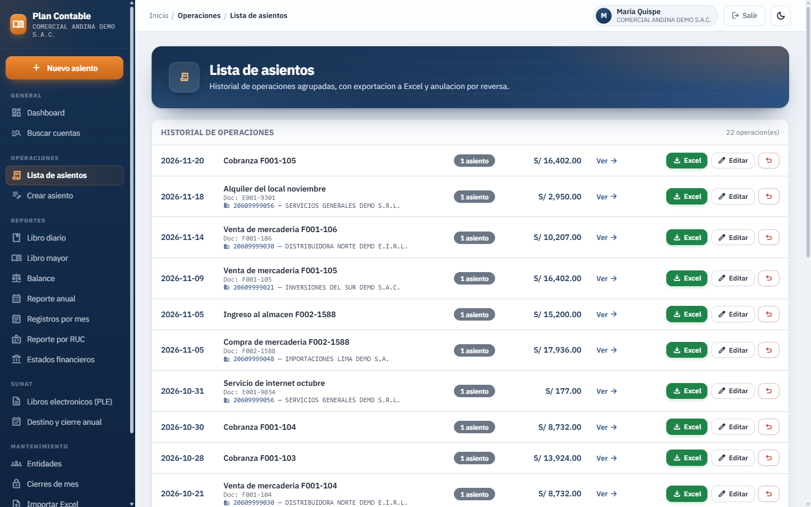
*Menú lateral a la izquierda y barra superior con tu nombre y tu empresa*

---

## 5. Dashboard

Es el resumen de tu empresa en una sola pantalla. Elige el mes y verás:

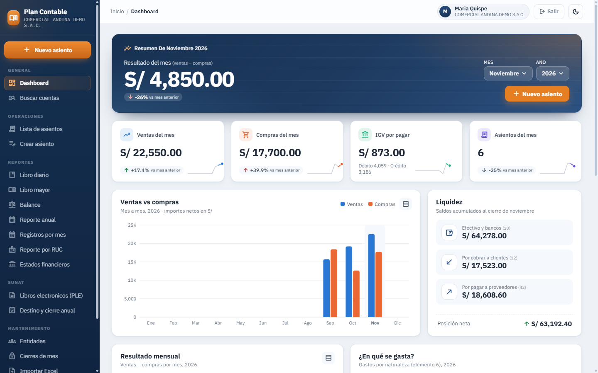
*Dashboard*

- **Indicadores del mes:** ventas, compras, margen, IGV y cantidad de asientos, comparados con el mes anterior.
- **Gráficos:** ventas contra compras mes a mes, el resultado de cada mes y en qué se va tu gasto.
- **Liquidez:** cuánto tienes en caja y bancos, cuánto te deben tus clientes y cuánto debes a tus proveedores.
- **Mejores clientes y principales proveedores.**
- **Últimas operaciones** registradas.

> El dashboard es una vista rápida y orientativa. Para cifras oficiales, usa los **reportes** y los **estados financieros**.

---

## 6. Buscar cuentas del PCGE

El catálogo completo del Plan Contable General Empresarial, más tus cuentas propias.

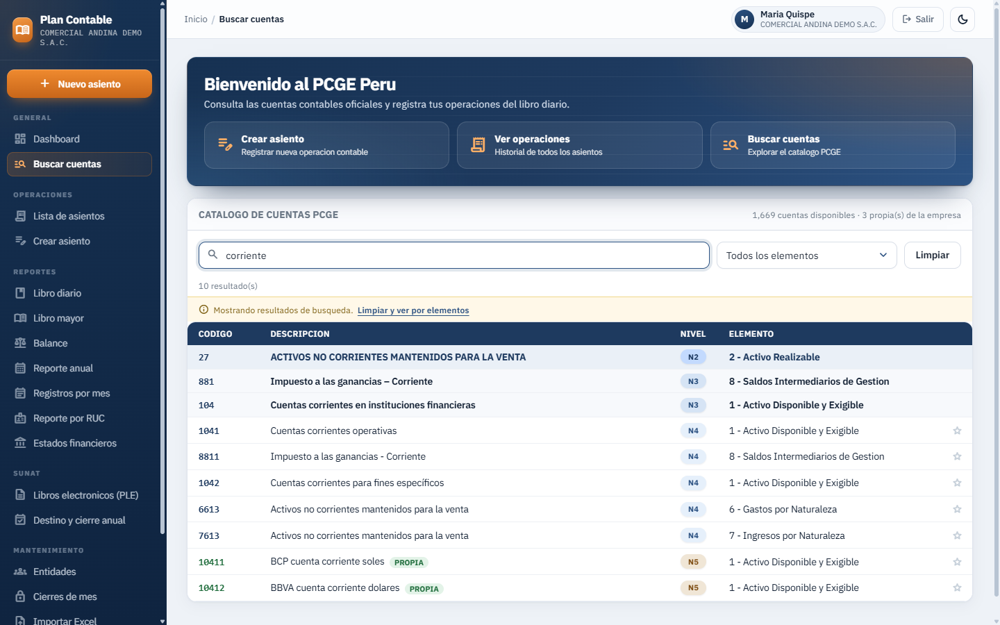
*Búsqueda de "corriente": aparecen las cuentas del PCGE y las cuentas propias de la empresa (PROPIA)*

- Busca por **código** (`4011`) o por **nombre** ("ventas").
- Entiende palabras del día a día: **"luz"** encuentra *energía eléctrica*, **"planilla"** encuentra *remuneraciones* y **"carro"** encuentra *vehículos*.
- Perdona los errores de tipeo: "vnetas" encuentra "ventas".
- Puedes filtrar por **elemento** (1 al 9).
- Marca con ⭐ tus cuentas **favoritas**: aparecerán primero cuando busques una cuenta al registrar un asiento.

---

## 7. Registrar un asiento

Entra a **Crear asiento** (o al botón **Nuevo asiento**).

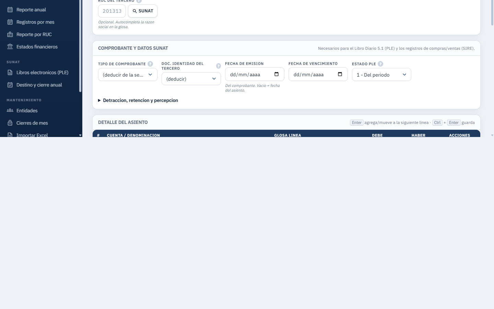
*Formulario para crear un asiento*

### Datos generales

- **Fecha** de la operación. No puede ser una fecha futura ni de un mes cerrado.
- **Moneda:** soles o dólares. Si es en dólares, escribe los montos en dólares y el tipo de cambio; el botón **SUNAT** trae el tipo de cambio *venta* publicado para esa fecha. La aplicación convierte todo a soles y guarda también el monto original en dólares.
- **N° de documento** (por ejemplo `F001-1234`) y **RUC del cliente o proveedor**. Con el botón **SUNAT** se completa su razón social.
- **Glosa:** una descripción corta de la operación.

### Comprobante y datos SUNAT

Para que tus registros de compras y ventas y tus libros electrónicos salgan completos:

- **Tipo de comprobante:** factura, boleta, nota de crédito, recibo por honorarios, etc. Si lo dejas vacío, se deduce de la serie (F = factura, B = boleta).
- **Documento del cliente o proveedor:** RUC, DNI, carné de extranjería o pasaporte.
- **Fechas de emisión y de vencimiento.**
- **Estado PLE:** *1* si la operación es del mes; *8* si es de un mes anterior que no se anotó; *9* si corrige un mes anterior.
- **Comprobante que modifica:** solo en notas de crédito y de débito, y en ellas es obligatorio.
- **Detracción, retención y percepción**, cuando corresponda.

### Las líneas del asiento

Cada línea lleva una **cuenta**, una **glosa** y un monto en el **Debe** o en el **Haber** (nunca en los dos).

- Busca la cuenta escribiendo su código o su nombre.
- Solo las cuentas de detalle llevan montos. Las cuentas "título" (por ejemplo, **40** o **401**) sirven para agrupar; la aplicación te avisa si eliges una.
- Abajo verás los totales del Debe y del Haber. El botón **Guardar** se activa solo cuando el asiento **cuadra**.
- **"Cuadrar en la última línea"** completa la diferencia por ti.

**Atajos de teclado:** `Enter` pasa a la línea siguiente y `Ctrl + Enter` guarda.

> Si cierras la página sin querer, no pierdes nada: el formulario guarda un **borrador** automáticamente.

### Aviso de comprobante repetido

Si intentas registrar un comprobante con el mismo número y el mismo RUC que otro que ya existe, la aplicación te avisa antes de guardar. Puedes cancelar o, si de verdad es otra operación, registrarlo igual.

### Guardar como plantilla

¿Registras lo mismo todos los meses (alquiler del local, internet, cuota de un préstamo)? Usa **Guardar como plantilla**: la próxima vez la encontrarás en **Usar plantilla → Plantillas de mi empresa**.

---

## 8. Usar plantillas: el asiento se arma solo

En vez de escribir línea por línea, presiona **Usar plantilla**. Tienes tres maneras de hacerlo:

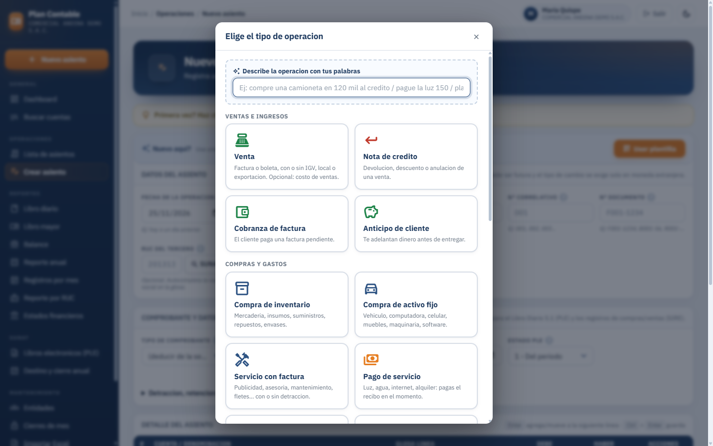
*Ventana de plantillas*

### a) Escribe la operación con tus palabras

Por ejemplo:

> *"compré una camioneta en 120 mil al crédito factura F001-555"*

La aplicación entiende la operación, sugiere la plantilla adecuada y deja llenos el monto, la forma de pago, el comprobante y el RUC. Con `Enter` se abre la primera sugerencia.

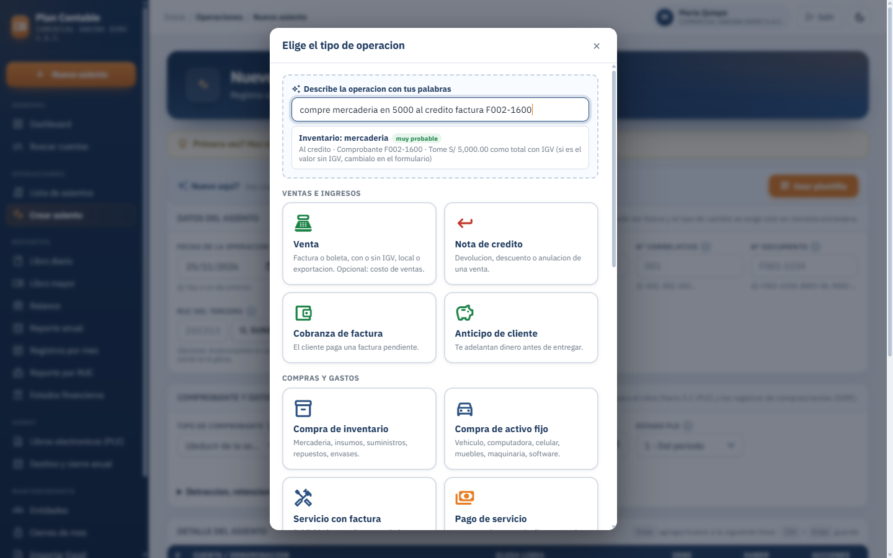
*La aplicación entiende la frase y sugiere la plantilla "Inventario: mercadería" con los datos llenos*

> **Revisa siempre los datos antes de aplicarla.** La sugerencia es una ayuda; la decisión contable es tuya.

### b) Elige una tarjeta

Las plantillas están ordenadas en **Ventas**, **Compras y gastos**, **Personal**, **Bancos** y **Activos**.

### c) Usa una plantilla de tu empresa

Las que guardaste antes con **Guardar como plantilla**.

### Lo que hacen las plantillas por ti

- Muestran una **vista previa** con cada cuenta, su nombre, por qué se usa y avisos importantes (detracción, límites tributarios de vehículos, PLAME, etc.).
- Calculan el IGV con la tasa de tu empresa. En ventas, compras y notas de crédito puedes escribir el **valor sin IGV** o el **total del comprobante**; con el total, el IGV se obtiene por diferencia y el asiento coincide exacto con el comprobante.
- Copian solos los datos SUNAT (tipo de comprobante, documento, fechas, detracción) al formulario.
- Las operaciones de varios asientos (por ejemplo: compra, ingreso al almacén y pago) se guardan **todas juntas o ninguna**. Nunca queda una operación a medias.

### Plantillas disponibles

| Plantilla | Qué registra |
|---|---|
| **Venta** | Mercadería, productos fabricados o servicios; con IGV, sin IGV o exportación; al contado, al crédito o mixta. Opcionalmente, el costo de ventas. |
| **Nota de crédito** | Devolución, descuento o anulación de una venta. |
| **Cobranza de factura** | El cobro de una venta al crédito. |
| **Anticipos** | Anticipo recibido de un cliente o entregado a un proveedor. |
| **Compra de inventario** | Mercadería, materias primas, materiales, suministros, repuestos, envases; incluye el ingreso al almacén. |
| **Compra de activo fijo** | Terrenos, edificios, vehículos, maquinaria, muebles, equipos de cómputo, software y más. Indica la tasa de depreciación. |
| **Servicio con factura** | Más de 60 conceptos: luz, agua, teléfono, internet, alquileres, transporte, asesorías, mantenimiento, publicidad, tributos y otros. Admite detracción. |
| **Pago de servicio** | Los mismos conceptos, con el IGV separado. Avisa los gastos que no llevan IGV o que no son deducibles. |
| **Recibo por honorarios** | Gasto, retención de 4.ª categoría (8 % si supera S/ 1,500) y honorarios por pagar. |
| **Importación** | Valor CIF, ad valorem, IGV e IPM de aduana, percepción e ingreso al almacén. |
| **Pago a proveedor** | El pago de una compra al crédito. |
| **Planilla / sueldos** | Sueldo, ONP o AFP, renta de 5.ª, neto a pagar, EsSalud y el pago. |
| **Depósito o retiro** | Traslados entre caja y bancos. |
| **Préstamo recibido / cuota** | El desembolso y cada cuota con capital, intereses y seguros. |
| **Diferencia de cambio** | Ganancia o pérdida al actualizar saldos en dólares. |
| **Depreciación mensual** | El gasto del mes según el tipo de activo. |
| **Aporte de capital** | Suscripción y pago de acciones o participaciones. |

En las listas largas (por ejemplo, *¿Qué pagaste?*) hay un **buscador**: escribe "agua" o "predial" y presiona `Enter`. Cada opción muestra su cuenta del PCGE. Si no encuentras lo que buscas, elige **Otra cuenta** y búscala en el plan contable.

---

## 9. Lista de asientos: revisar, corregir y anular

Aquí ves todo lo que registraste, agrupado por **operación**: por ejemplo, una venta y su cobranza aparecen juntas.

*Lista de asientos*

- **Filtra** por mes, por rango de fechas o por RUC.
- Las operaciones **mixtas** (parte al contado y parte al crédito) muestran el **saldo pendiente** y un botón para registrar el **cobro o pago del saldo** en un clic.
- **Exporta a Excel** una operación completa.

Al abrir un asiento ves todos sus datos, quién lo registró y quién lo modificó. Desde ahí puedes:

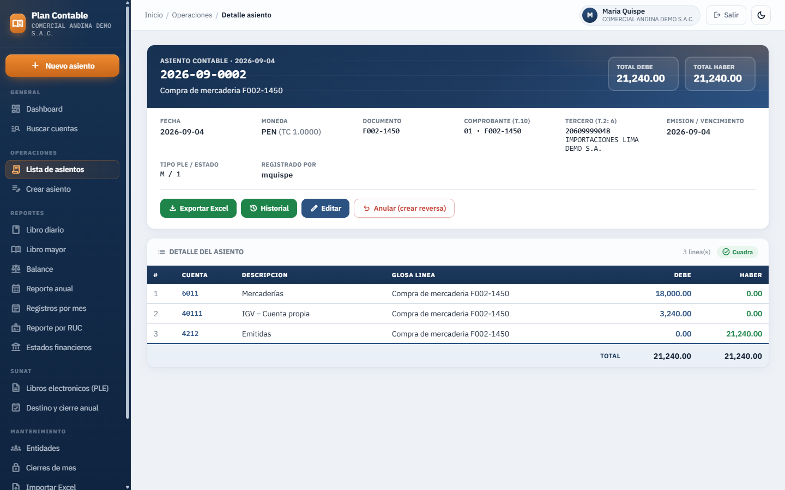
*Detalle de un asiento*

- **Editar:** la aplicación te pide el **motivo** del cambio. Un asiento no se puede mover a otro mes.
- **Anular:** también pide el motivo. *(Lee "Reglas que debes conocer" para saber cómo funciona.)*
- **Ver su historial** de cambios.
- **Exportar a Excel.**

---

## 10. Reportes

| Reporte | Qué te muestra |
|---|---|
| **Libro diario** | Todos los asientos en orden de fecha, con sus líneas y totales. |
| **Libro mayor** | Los movimientos y el saldo de cada cuenta. Puedes filtrar una cuenta o un grupo (por ejemplo, todo lo que empieza con `42`). |
| **Balance de comprobación** | Sumas del Debe y del Haber y saldos de cada cuenta, para comprobar que todo cuadre. |
| **Reporte anual** | El año completo: cuadre general, detalle mes por mes, totales por elemento y las cuentas con más movimiento. |
| **Registros por mes** | Tu **Registro de Compras** y **Registro de Ventas** del mes, con base, IGV y total. Te **avisa los comprobantes con datos incompletos**. Ideal para comparar con la propuesta del **SIRE**. |
| **Reporte por RUC** | Compras y ventas acumuladas por cada cliente o proveedor. Te sirve para la **DAOT**. |
| **Estados financieros** | **Estado de Situación Financiera** y **Estado de Resultados** (por naturaleza y por función). Elige el año y la fecha de corte; puedes imprimirlos o guardarlos en PDF. |

Casi todos los reportes se pueden **exportar a Excel**.

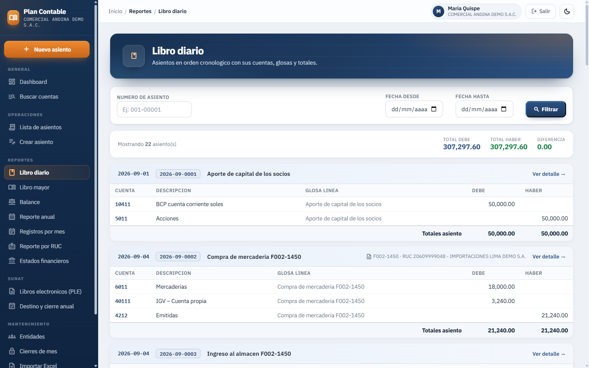
*Libro diario*

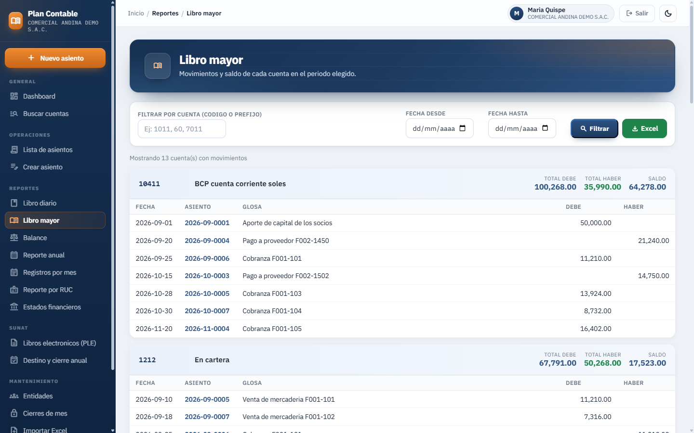
*Libro mayor*

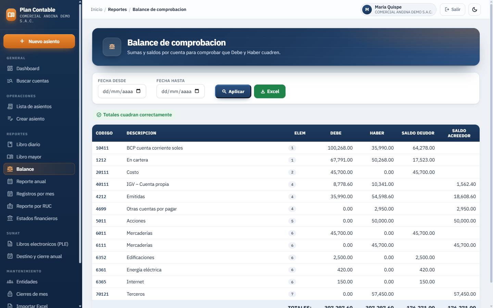
*Balance de comprobación*

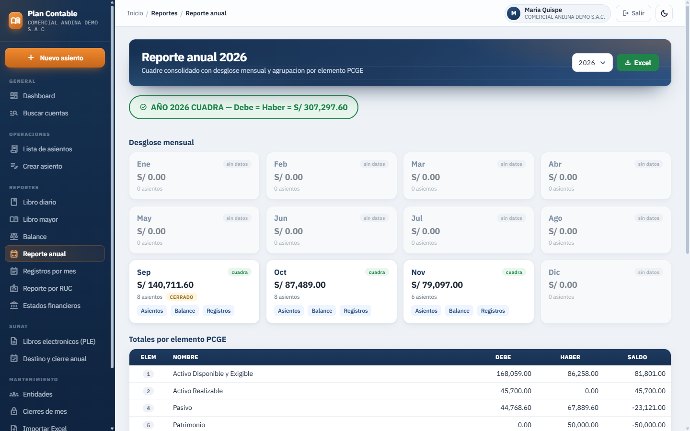
*Reporte anual*

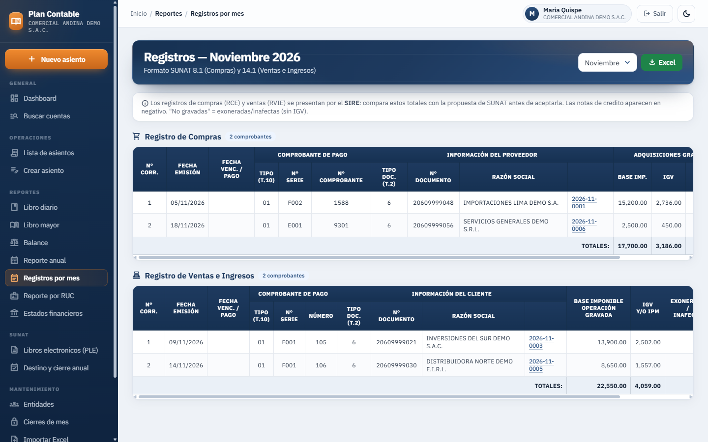
*Registros de compras y ventas del mes*

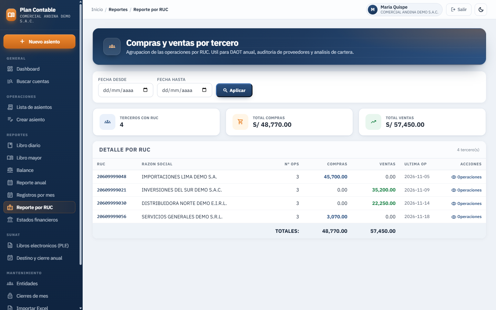
*Reporte por RUC*

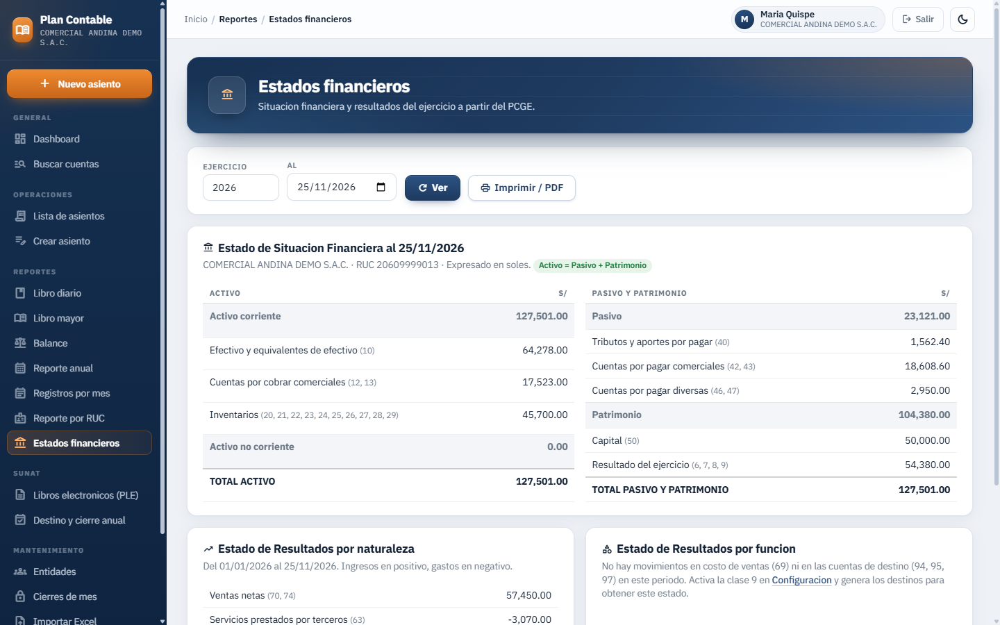
*Estados financieros*

---

## 11. Libros electrónicos (PLE) de SUNAT

La aplicación genera los archivos **.txt** que cargas en el **Programa de Libros Electrónicos (PLE)** de SUNAT:

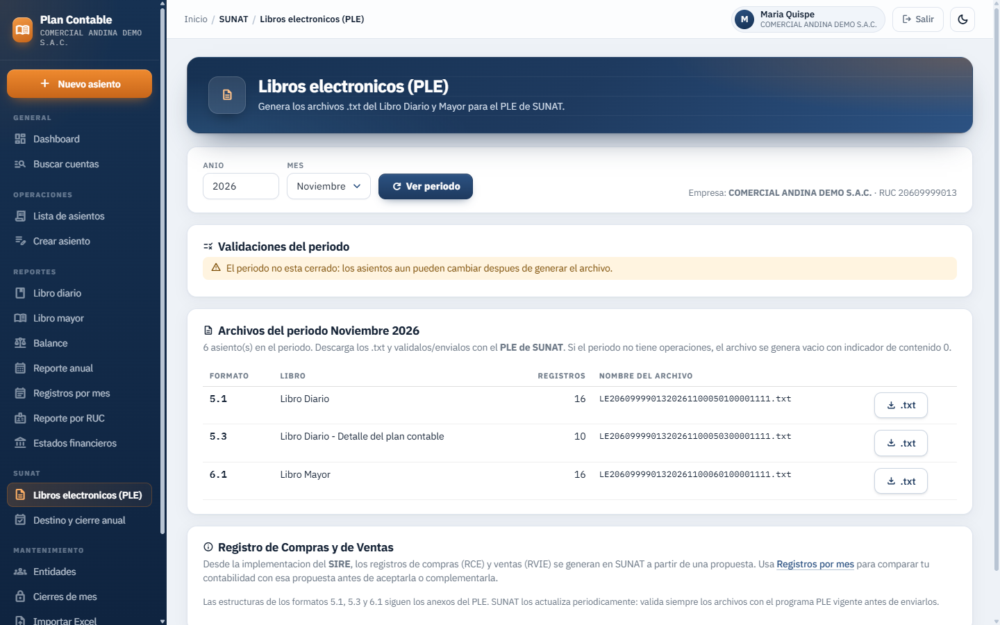
*Libros electrónicos: validaciones y archivos del mes listos para descargar*

| Formato | Contenido |
|---|---|
| **5.1** | Libro Diario |
| **5.3** | Libro Diario: detalle del plan contable usado |
| **6.1** | Libro Mayor |

**Cómo descargarlos:**

1. Elige el **año** y el **mes**.
2. Revisa las **validaciones**: la aplicación te avisa si el mes no está cerrado, si hay asientos que no cuadran, cuentas que no existen o si falta el RUC de tu empresa.
3. Descarga cada archivo. El nombre ya sale con el formato que pide SUNAT.

Si el mes no tuvo movimiento, el archivo sale vacío con el indicador de "sin información", tal como lo pide SUNAT.

> **Recomendación:** cierra el mes antes de descargar, y valida siempre los archivos en el PLE antes de enviarlos.

---

## 12. Destino de gastos y cierre del año

### Asientos de destino (clase 9)

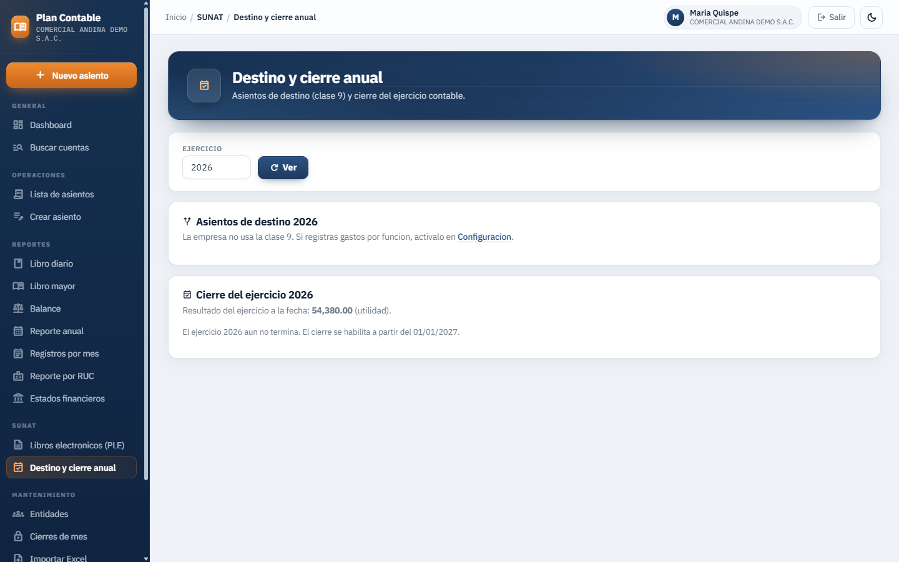
*Destino de gastos y cierre del ejercicio*

Solo si tu empresa registra sus gastos por función (actívalo en **Configuración**).

- La pantalla muestra, mes a mes, los gastos de las cuentas **62 a 68** y lo que ya se destinó.
- El botón **Generar** crea el asiento de destino por la diferencia, repartido según los porcentajes que configuraste (por ejemplo, 60 % administración y 40 % ventas).
- Si después registras más gastos en ese mes, vuelves a generar y solo se agrega lo que falta.

### Cierre del ejercicio

Se habilita desde el **1 de enero** del año siguiente. Antes de cerrar, registra el impuesto a la renta, la depreciación y los ajustes del año, y genera los destinos que falten.

Con un clic, la aplicación crea automáticamente:

1. El cierre de las cuentas de resultados.
2. El traslado de la utilidad o pérdida a resultados acumulados.
3. El cierre de las cuentas de balance.
4. El **asiento de apertura** del nuevo año.

---

## 13. Entidades: clientes y proveedores

Tu agenda de clientes y proveedores.

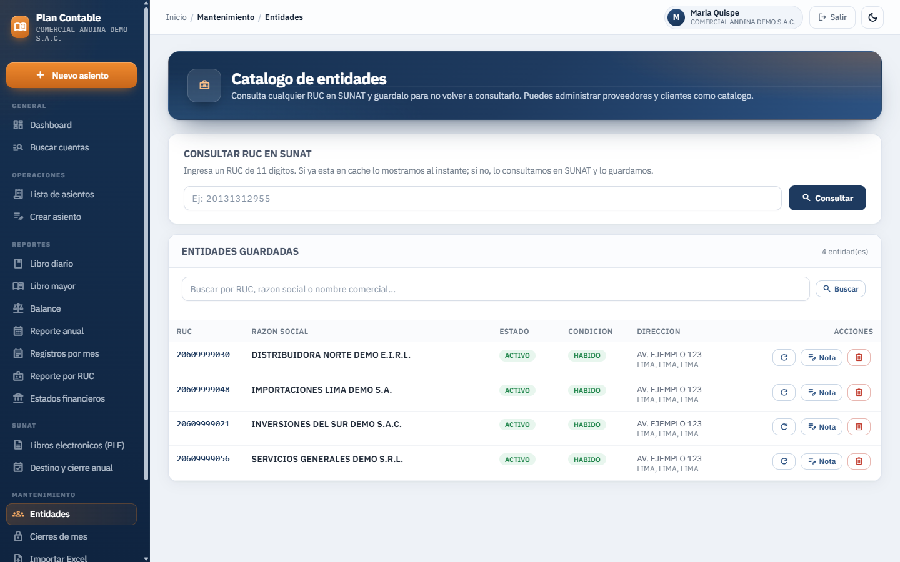
*Entidades*

- Escribe un **RUC** y consulta SUNAT: trae la razón social, el estado, la condición y la dirección.
- Queda guardado para que, la próxima vez, al escribir ese RUC en un asiento, los datos aparezcan al instante.
- Puedes editar o eliminar entidades y agregarles notas.

---

## 14. Cierre de mes

Cuando terminas de trabajar un mes, **ciérralo**. Un mes cerrado queda **protegido**: nadie puede registrar, editar ni anular asientos en ese periodo.

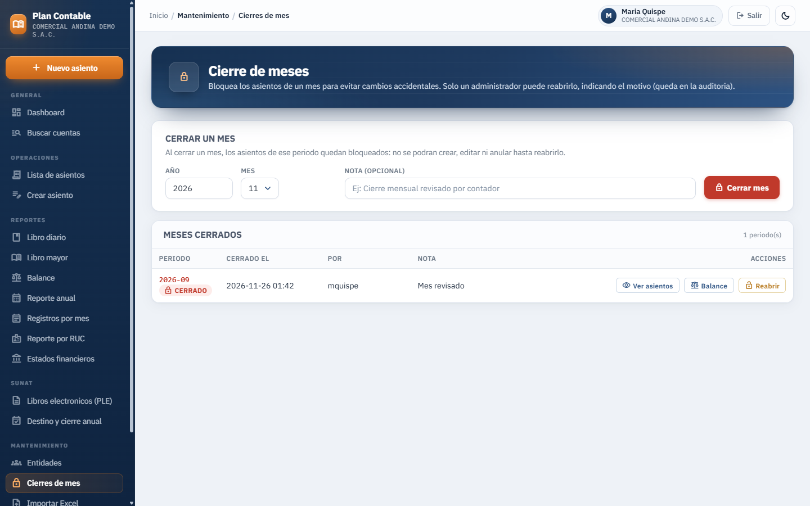
*Cierres de mes*

Si necesitas corregir algo, puedes **reabrirlo** indicando un **motivo**, que queda guardado en el historial.

---

## 15. Importar asientos desde Excel

¿Tienes muchas operaciones en una hoja de cálculo? Cárgalas de una sola vez:

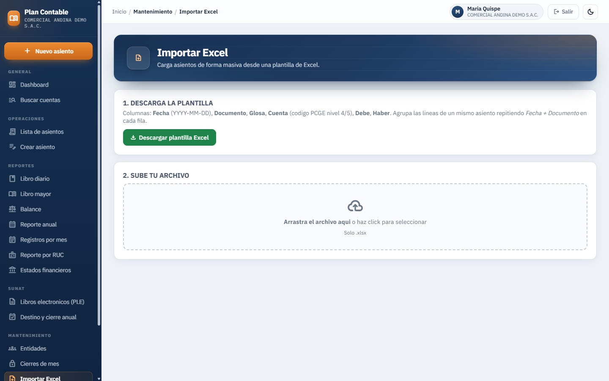
*Importar desde Excel*

1. **Descarga la plantilla** de Excel.
2. Llénala con tus asientos y **súbela**.
3. Revisa la **vista previa**: te muestra qué asientos no cuadran o tienen errores.
4. **Confirma** la importación.

Si algún asiento cae en un mes cerrado, la importación se cancela completa, para que no quede nada a medias.

---

## 16. Auditoría: el historial de cambios

Un registro de todo lo que pasa en tu contabilidad: asientos creados, editados (con los datos de antes y de después) y anulados, cierres y reaperturas de mes, descargas del PLE e inicios de sesión.

Cada evento muestra **quién**, **cuándo** y **por qué**. Este historial **no se puede modificar ni borrar**: es tu respaldo ante cualquier revisión.

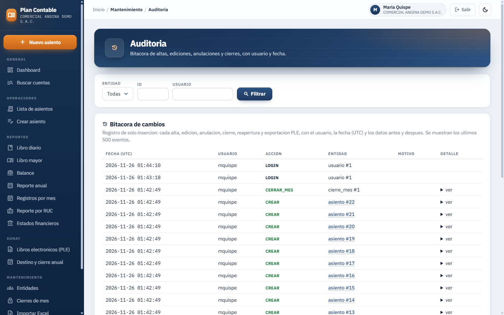
*Auditoría*

---

## 17. Configuración

Aquí cambias, cuando lo necesites:

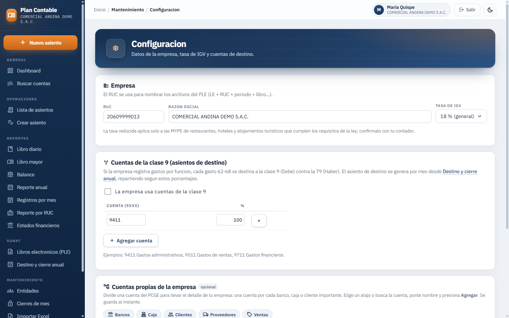
*Configuración de la empresa*

- **RUC** y **razón social** de tu empresa.
- **Tasa de IGV** (18 % o 10.5 %).
- **Clase 9:** si tu empresa registra los gastos por función, y cómo se reparten (cuentas 9 y porcentajes, que deben sumar 100 %). Ejemplos: 9411 Gastos administrativos, 9511 Gastos de ventas, 9711 Gastos financieros.
- **Cuentas propias (subdivisionarias):** crear o quitar las cuentas de detalle de tu empresa (ver la [sección 3](#3-cuentas-propias-subdivisionarias)).

Presiona **Guardar configuración** para aplicar los cambios.

---

## 18. Tu rutina de cada mes

1. **Registra** las operaciones del mes, de preferencia con **plantillas**, y completa los datos SUNAT de cada comprobante.
2. Revisa **Registros por mes**: corrige los comprobantes incompletos y compara con el **SIRE**.
3. Si usas la clase 9, **genera el destino** del mes.
4. Revisa el **Balance de comprobación** y el **Libro mayor**.
5. **Cierra el mes.**
6. Descarga los **.txt del PLE** (5.1, 5.3 y 6.1), valídalos y envíalos a SUNAT.

**A fin de año:** registra los ajustes y el impuesto a la renta, revisa los **Estados financieros** y ejecuta el **cierre del ejercicio**.

---

## 19. Reglas que debes conocer

- **Partida doble siempre:** ningún asiento se guarda si el Debe y el Haber no son iguales.
- **Los asientos no se borran, se anulan.** Al anular, la aplicación crea un asiento de **reversa** (con el Debe y el Haber invertidos) y marca el original como anulado. Así se conserva el orden correlativo que exige SUNAT. Si el mes sigue abierto, la reversa queda en ese mismo mes; si ya está cerrado, se registra en el mes actual como corrección.
- **Toda edición pide un motivo** y queda en el historial.
- **Mes cerrado = mes protegido**, hasta que lo reabras con un motivo.
- **Los asientos automáticos** (destino, cierre y apertura) no se editan: si hay que corregirlos, se anulan y se vuelven a generar.
- **Las notas de crédito y de débito** siempre indican el comprobante que modifican.
- **Moneda extranjera:** los libros quedan en soles, y el monto original en dólares se guarda aparte.

---

## 20. Preguntas frecuentes

**¿Alguien más puede ver mi contabilidad?**
No. Tu cuenta es independiente: tus asientos, reportes y configuración solo los ves tú.

**Olvidé mi contraseña, ¿qué hago?**
Comunícate con el soporte de la aplicación para que te asignen una nueva.

**Me equivoqué en un asiento, ¿cómo lo corrijo?**
Si el mes está abierto, ábrelo desde la **Lista de asientos** y presiona **Editar** (te pedirá el motivo). También puedes **anularlo** y registrarlo de nuevo.

**Necesito corregir un mes que ya cerré.**
Reabre el mes en **Cierres de mes** indicando el motivo, haz la corrección y vuelve a cerrarlo.

**¿Por qué no puedo poner un monto en una cuenta?**
Porque es una cuenta "título" que solo agrupa a otras. Usa una de sus subcuentas o crea una **cuenta propia** debajo de ella.

**¿Por qué el botón Guardar está desactivado?**
Porque el asiento no cuadra: el Debe y el Haber deben ser iguales. Usa **"Cuadrar en la última línea"** si la diferencia es por redondeo.

**¿Puedo usar la aplicación desde el celular?**
Sí. Se adapta a la pantalla; el menú se abre con el botón ☰.

**¿Los archivos del PLE están listos para enviar?**
Sí, siguen el formato de SUNAT. Aun así, valídalos siempre en el programa PLE antes de enviarlos, porque SUNAT actualiza sus formatos periódicamente.
